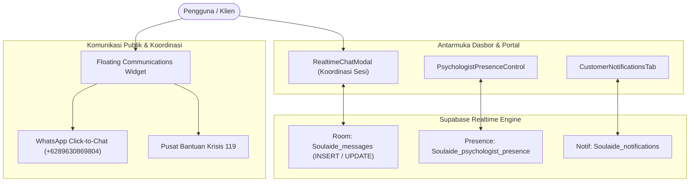

# Phase 10 — Communications Implementation

Dokumentasi implementasi fitur komunikasi real-time, integrasi WhatsApp Click-to-Chat, pemantauan kehadiran psikolog (*presence*), sistem notifikasi, dan protokol penanganan krisis kedaruratan mental (*crisis escalation*) pada platform psikologi Soulaide.

---

## 1. Ikhtisar & Arsitektur Komunikasi

Sistem komunikasi Soulaide dirancang untuk menjamin kemudahan koordinasi pra-konseling dan informasi publik tanpa mengorbankan privasi data klinis dan kepatuhan kode etik psikologi HIMPSI.

---

## 2. WhatsApp Click-to-Chat

### 2.1 Konfigurasi Nomor & Standar Format
- **Nomor Layanan Resmi:** `+6289630869804` (dikonfigurasi dengan fallback dinamis dari tabel `Soulaide_site_settings`).
- **Normalisasi Nomor (`normalizeWhatsAppNumber`):** Mengonversi berbagai variasi format nomor Indonesia (`08...`, `+628...`, `8...`) menjadi standar internasional `6289630869804` untuk URL `https://wa.me/6289630869804`.

### 2.2 Template Pesan Operasional Terstandarisasi
Tersedia 4 template resmi yang mencegah kebocoran data sensitif:
1. **Pertanyaan Umum Layanan:** `"Halo Soulaide, saya ingin bertanya mengenai layanan dan alur konseling psikologi."`
2. **Bantuan Pendaftaran / Jadwal:** `"Halo Soulaide, saya membutuhkan panduan dalam memilih jadwal konsultasi psikolog."`
3. **Perubahan Jadwal (Reschedule):** `"Halo Soulaide, saya ingin meminta bantuan perihal pengajuan perubahan jadwal sesi saya (min. 8 jam sebelum sesi)."`
4. **Bantuan Teknis / Link Pertemuan:** `"Halo Soulaide, saya mengalami kendala teknis terkait tautan panggilan sesi konsultasi saya."`

### 2.3 Aturan Privasi Klinis (Sanitizer Data)
Fungsi `validateSafeWhatsAppContent` secara otomatis mendeteksi dan menolak pesan WhatsApp yang mengandung informasi klinis/medis rahasia:
- Catatan klinis (*clinical notes*)
- Diagnosis psikiatri
- Jawaban atau skor asesmen MHCU / DASS-21
- Kredensial akun / kata sandi

---

## 3. Realtime Chat Engine

### 3.1 Kanal Koordinasi Sesi Klien-Psikolog
- **Tabel Basis Data:** `public."Soulaide_conversations"`, `public."Soulaide_conversation_participants"`, dan `public."Soulaide_messages"`.
- **Inisialisasi Otomatis (`getOrCreateBookingConversation`):** Membuka ruang obrolan unik untuk setiap booking terkonfirmasi dan mendaftarkan klien serta psikolog penanggung jawab.
- **Pesan Selamat Datang Sistem:** Memuat arahan otomatis bahwa kanal ini khusus koordinasi pra-sesi (konfirmasi koneksi video/ruang tatap muka).
- **Supabase Realtime Subscription:** Mendengarkan event `INSERT` dan `UPDATE` pada tabel `Soulaide_messages` dengan filter `conversation_id=eq.{id}` untuk pembaruan pesan instan tanpa polling.
- **Tanda Pesan Terbaca (*Read Receipts*):** Otomatis memperbarui `is_read = true` saat lawan bicara membuka ruang obrolan.

---

## 4. Presence Engine (Kehadiran Psikolog)

### 4.1 Definisi Status Kehadiran
Sesuai panduan arsitektur Soulaide, terdapat 5 status kehadiran resmi:
1. `offline`: Tidak terhubung ke sistem.
2. `online`: Sedang online di sistem.
3. `available`: Sedang online dan bersedia menerima koordinasi chat/sesi (*Siap Melayani*).
4. `busy`: Sedang melayani sesi konseling klien (*Sedang Sesi*).
5. `away`: Sementara tidak aktif di tempat / jeda antar sesi (*Istirahat*).

> [!NOTE]
> Status `online` tidak otomatis berarti `available`. Psikolog memegang kendali penuh melalui kontrol status `PsychologistPresenceControl` di dasbor mereka.

---

## 5. Protokol Eskalasi Krisis & Kedaruratan Mental

### 5.1 Penegasan Batasan Hukum & Etis
Live Chat dan WhatsApp Soulaide **BUKAN** merupakan layanan tanggap darurat mental atau pengganti penanganan krisis bunuh diri.

### 5.2 Kontak Resmi Kedaruratan 24 Jam
Komponen `CrisisDisclaimerBanner` dan `CrisisEscalationModal` menyediakan tombol panggilan cepat (`tel:`) ke:
- **Hotline Kesehatan Jiwa Kemenkes RI:** `119 ext. 8` (24 Jam)
- **Sejiwa (HIMPSI & KemenPPPA/Kemenkes):** `119 ext. 8` (24 Jam)
- **Ambulans Gawat Darurat (SPGDT):** `118` / `119` (24 Jam)
- **Halo Kemkes:** `1500-567` (Informasi faskes dan rujukan psikiatri)
- **Rujukan IGD Rumah Sakit Terdekat**

---

## 6. Hak Akses & Kebijakan Keamanan (RLS)

File migrasi `supabase/migrations/20261122000008_create_soulaide_communications_policies.sql` menetapkan:
1. `Soulaide_conversations`: Hanya partisipan terdaftar dan admin yang dapat melihat percakapan.
2. `Soulaide_conversation_participants`: Akses SELECT dan INSERT dibatasi pada pengguna yang terotentikasi.
3. `Soulaide_messages`: Hanya pengirim yang terverifikasi sebagai partisipan yang dapat mengirim pesan; pembaruan `is_read` hanya untuk pesan dalam percakapan yang diikuti.
4. Publikasi Supabase Realtime: Menambahkan `Soulaide_messages`, `Soulaide_psychologist_presence`, dan `Soulaide_notifications` ke `supabase_realtime`.

---

## 7. Rangkuman File yang Dibuat & Diperbarui

| Berkas | Jenis | Deskripsi |
| :--- | :--- | :--- |
| `supabase/migrations/20261122000008_create_soulaide_communications_policies.sql` | SQL Migration | RLS policies percakapan, pesan, notifikasi & publikasi Realtime. |
| `src/features/chat/types.ts` | TypeScript Types | Definisi `ChatMessage`, `PresenceStatus`, `WhatsAppTemplate`, `CrisisHotline`. |
| `src/features/chat/whatsappService.ts` | Logic Service | Sanitasi nomor telepon, pembuat URL wa.me, proteksi data klinis. |
| `src/features/chat/crisisService.ts` | Logic Service | Direktori kontak darurat 119 ext 8, deteksi kata kunci krisis. |
| `src/features/chat/chatService.ts` | Data Service | Pengelola pesan percakapan dan Supabase Realtime channel. |
| `src/features/chat/presenceService.ts` | Data Service | Pelacak status kehadiran psikolog via Supabase Realtime. |
| `src/features/chat/notificationService.ts` | Data Service | Manajemen dan pendengar realtime notifikasi pengguna. |
| `src/features/chat/CrisisDisclaimerBanner.tsx` | Component | Banner peringatan gawat darurat dengan akses kontak darurat. |
| `src/features/chat/CrisisEscalationModal.tsx` | Component | Modal interaktif daftar kontak darurat 24 jam dengan tombol dial langsung. |
| `src/features/chat/WhatsAppButton.tsx` | Component | Tombol Click-to-Chat dengan pemilih template pesan terstandarisasi. |
| `src/features/chat/RealtimeChatModal.tsx` | Component | Modal chat real-time interaktif antara klien dan psikolog penanggung jawab. |
| `src/features/chat/FloatingCommunicationsWidget.tsx` | Component | Widget melayang di pojok kanan bawah seluruh halaman publik dan portal. |
| `src/components/shared/Layout.tsx` | Component | Mengintegrasikan `FloatingCommunicationsWidget`. |
| `src/features/customer/CustomerChatModal.tsx` | Component | Menghubungkan modal chat klien ke mesin realtime chat baru. |
| `src/features/customer/CustomerDashboardPage.tsx` | Component | Mengaktifkan langganan real-time notifikasi pengguna. |
| `src/features/public-site/ContactPage.tsx` | Component | Menggunakan `CrisisDisclaimerBanner` terintegrasi. |
| `src/features/chat/chat.test.ts` | Test Suite | 8 pengujian unit untuk WhatsApp, disclaimers, dan presence. |

---

## 8. Status Verifikasi

- **Typecheck:** Lulus tanpa galat (`tsc -b`).
- **Linting:** Lulus tanpa pelanggaran ESLint (`eslint .`).
- **Unit Testing:** Lulus 9 test suite (55/55 tests passed).
- **Production Build:** Lulus kompilasi bundel produksi di direktori `dist/`.
